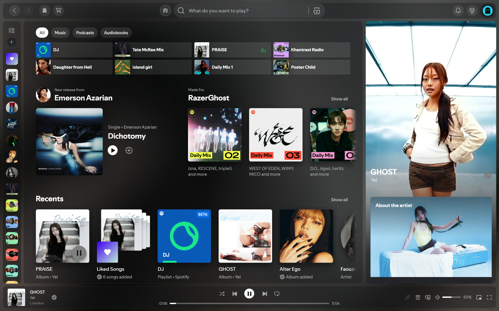
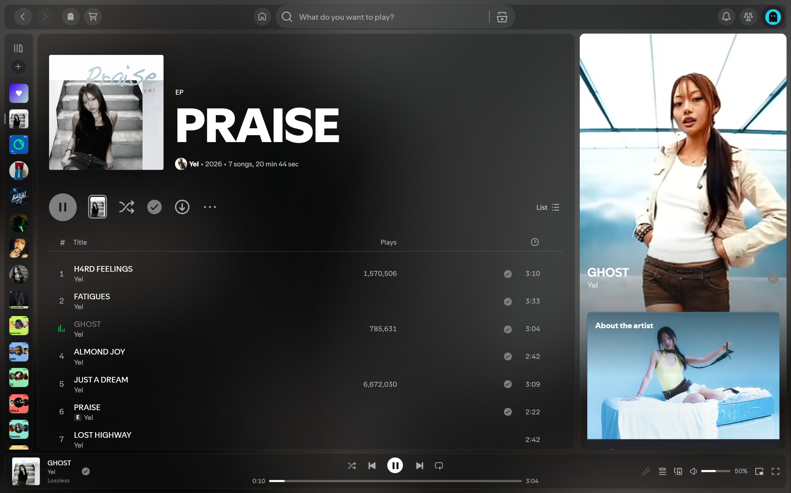
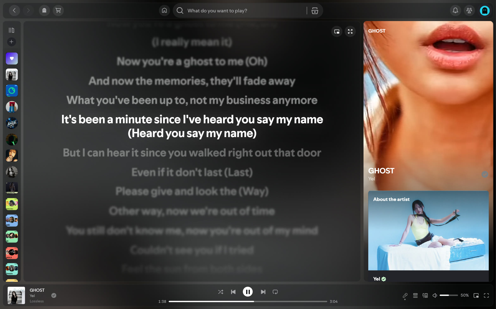
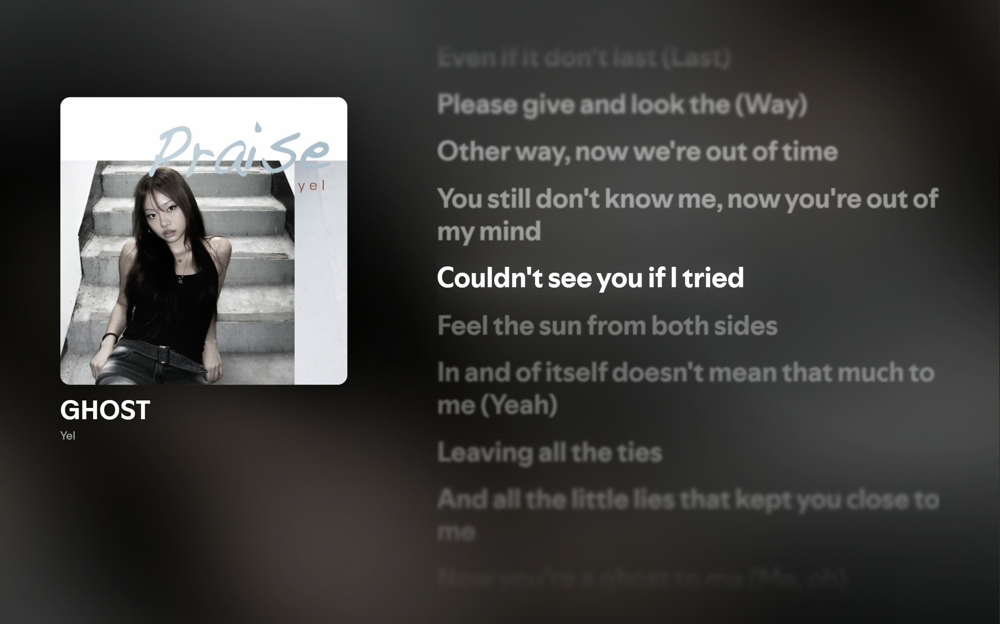
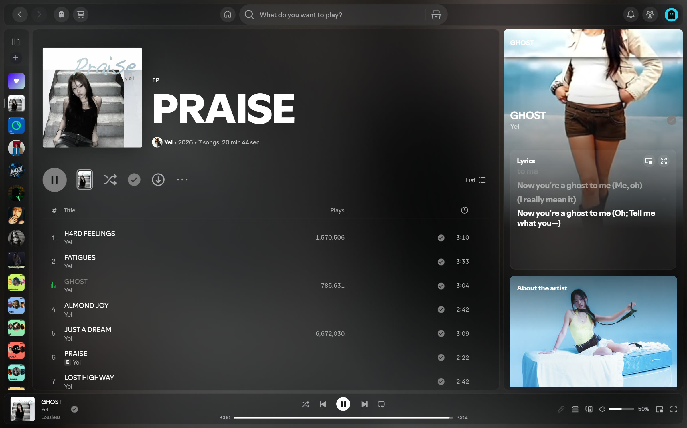
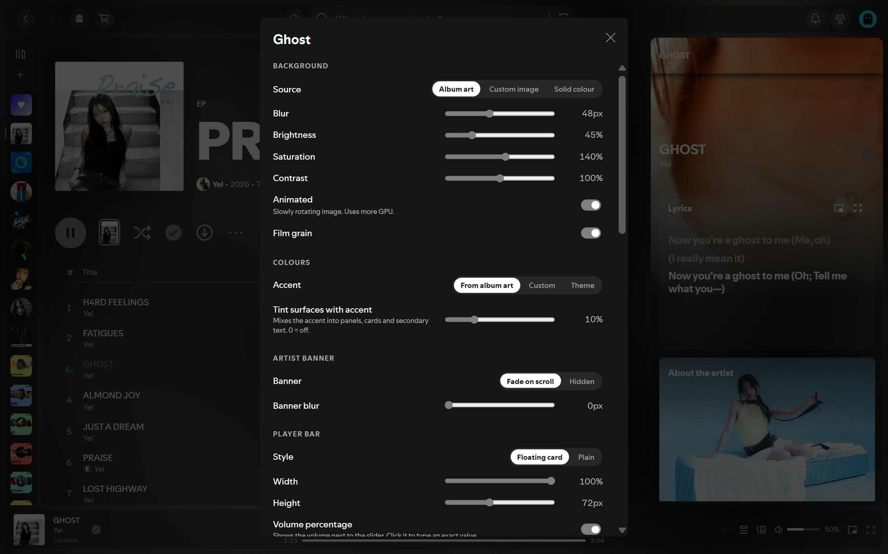
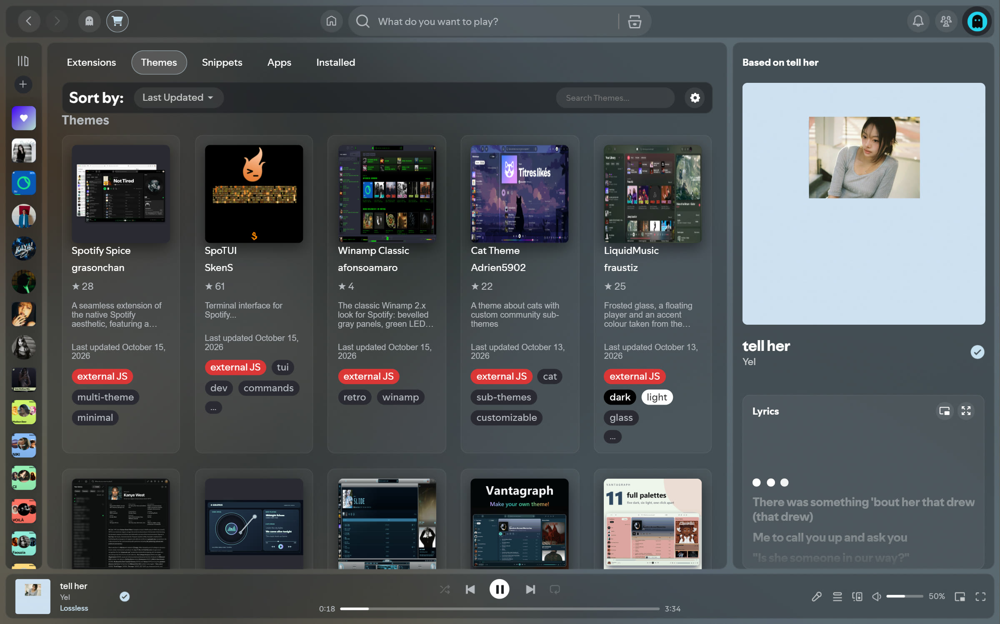
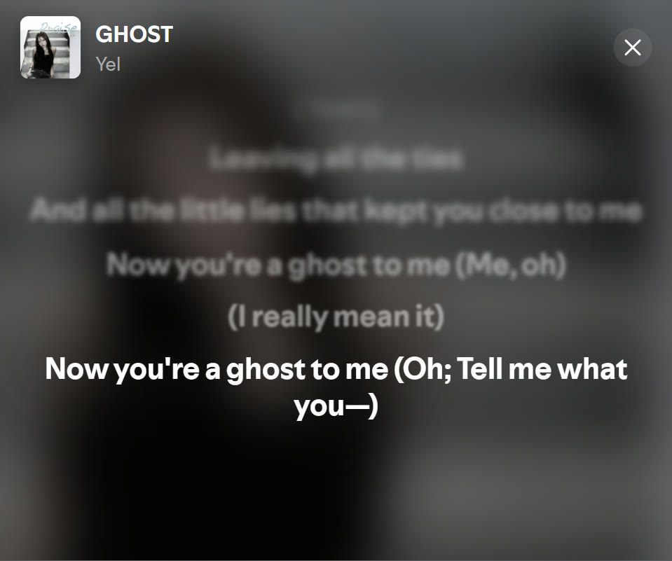

# Ghost

A lightweight, glassy [Spicetify](https://spicetify.app) theme with built-in synced
lyrics. Inspired by [Lucid](https://github.com/sanoojes/spicetify-lucid) and
[Hazy](https://github.com/Astromations/Hazy), but written to stay small: the look is
plain CSS, and the JS (~50 KB) uses Spotify's own React instead of bundling one.

## Features

- **Background** — blurred album art (or a custom image / solid colour), baked once
  per song into a small canvas so it costs nothing per frame; optional animation and
  film grain.
- **Glass UI** — translucent panels, top bar and player bar; accent colour from the
  album art, optionally mixed into every surface ("tint").
- **Lyrics** — replaces Spotify's lyrics page. Word-synced lyrics from the
  [AMLL TTML DB](https://github.com/amll-dev/amll-ttml-db) (duets, background vocals),
  otherwise Spotify's own lyrics, otherwise [LRCLIB](https://lrclib.net). Also a
  fullscreen view (Spotify's fullscreen button) — the whole screen when Spotify is
  maximised, just Spotify's window when it isn't (e.g. split-screen) — a card in
  the now-playing view and a picture-in-picture window. Optional romanization for
  Korean, Japanese and Chinese.
- **Player** — volume percentage (click to type a value, scroll over the slider to
  fine-tune), floating player bar.
- **Spicetify Marketplace** styled to match.

Everything is configurable from the ghost button in the top bar.

## Screenshots



| | |
| --- | --- |
|  |  |
|  |  |
|  |  |

Picture-in-picture lyrics:



## Install

You need [Spicetify](https://spicetify.app) installed first.

### Spicetify Marketplace (recommended)

Open the Marketplace in Spotify → **Themes** → search for **Ghost** → **Install**.
Updates arrive on their own when you restart Spotify.

### Install script

Windows (PowerShell):

```powershell
iwr -useb https://raw.githubusercontent.com/RazerGhost/spicetify-ghost/main/install.ps1 | iex
```

macOS / Linux:

```sh
curl -fsSL https://raw.githubusercontent.com/RazerGhost/spicetify-ghost/main/install.sh | sh
```

This sets Ghost as your theme and restarts Spotify. It also updates itself: new
versions load the next time you start Spotify, and it keeps working offline.

### By hand

Download the [built theme as a ZIP](https://github.com/RazerGhost/spicetify-ghost/archive/refs/heads/dist.zip),
extract it into Spicetify's `Themes` folder (`spicetify path userdata` shows where),
rename the folder to `Ghost`, then:

```sh
spicetify config inject_css 1 replace_colors 1 overwrite_assets 1 inject_theme_js 1
spicetify config current_theme Ghost color_scheme dark
spicetify apply
```

A hand install doesn't update itself; repeat these steps to update.

## Colour schemes

Ghost comes with `dark` (default) and `oled` (pure black). The accent colour follows
the album art unless you change it in Ghost's settings.

- **Marketplace:** pick the scheme in the Marketplace settings.
- **Script or hand install:** run the installer with `-Scheme oled` (PowerShell) or
  `sh -s -- --scheme oled` (macOS / Linux), or:

  ```sh
  spicetify config color_scheme oled
  spicetify apply
  ```

## Settings

Click the ghost button in the top bar. Everything is there: background source, blur
and brightness, accent and tint, player bar style, lyrics options, top bar and library
behaviour, and panel opacity, corners and spacing.

## Uninstall

- **Marketplace:** open the Marketplace → **Installed** → Ghost → **Remove**.
- **Script or hand install:** switch to another theme, e.g. back to the Marketplace:

  ```sh
  spicetify config current_theme marketplace
  spicetify apply
  ```

## Problems?

Spotify updates sometimes change the parts of the app Ghost styles. If something looks
broken after an update, [open an issue](https://github.com/RazerGhost/spicetify-ghost/issues)
with your Spotify version (Settings → About) and a screenshot.

## Contributing

See [DEVELOPMENT.md](DEVELOPMENT.md) for the dev setup, debugging helpers, project
layout and how releases work.

## License

[MIT](LICENSE)
